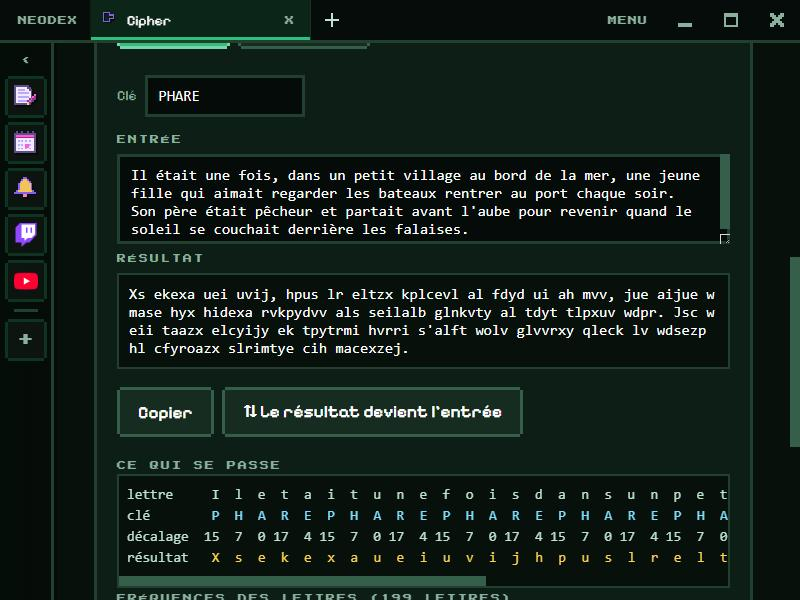

# Cipher

Try and understand nine encryption methods, from the oldest to the real ones of today: for each, encrypt, decrypt, see what happens to every letter and learn how it is broken.

*Version française : [README.md](README.md)*

## The methods

| Method | What it does | What the app shows |
|---|---|---|
| **Caesar** | shifts every letter by the same amount | the plain and cipher alphabets, the 26 shifts ranked from most to least French-looking (a click decrypts) |
| **Vigenère** | one shift per letter of a repeating key | letter, key, shift and result, column by column; **Break** finds the key by itself on a text of at least 60 letters |
| **Atbash** | the alphabet backwards | the 26-letter mapping |
| **Substitution** | a shuffled alphabet (**Shuffle** button) | the mapping, and the frequencies that give it away |
| **Rail fence** | letters written in a zigzag over 2 to 10 lines | the zigzag drawn out |
| **Morse** | dots and dashes (an encoding, not encryption) | — |
| **XOR** | bytes mixed with a key, in hexadecimal | the one-time pad explained |
| **AES-256-GCM** | the real encryption of today, with a password | a different result every time, and a clear refusal if the password is wrong or the text was changed |
| **SHA-256** | a fingerprint, with no way back | the avalanche effect: one added full stop changes almost the whole fingerprint |

For letter methods, a **histogram** compares the encrypted text's frequencies (pink) with French (blue). Each method has a paragraph about its history and its weakness.

**⇅ The result becomes the input** swaps both areas and switches between Encrypt and Decrypt.

## Accents

Old methods only know 26 letters: "é" becomes "e", "œ" becomes "oe". AES, XOR and SHA-256 keep the whole text as is (UTF-8).

## Data

The method, the text and the keys are kept in the plugin's folder. **The AES password is never saved.** Everything is computed on your PC (AES and SHA-256 by the browser's crypto engine). Permission: `storage` only.
