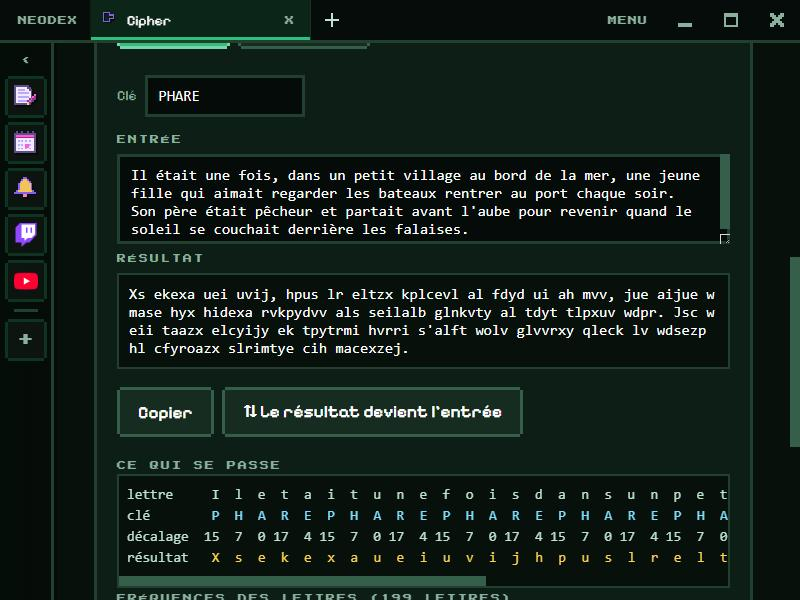

# Cipher

Essaie et comprends neuf méthodes de chiffrement, des plus anciennes aux vraies d'aujourd'hui : pour chacune, chiffrer, déchiffrer, voir ce qui arrive à chaque lettre et apprendre comment on la casse.

*English version: [README.en.md](README.en.md)*

## Les méthodes

| Méthode | Ce qu'elle fait | Ce que l'appli montre |
|---|---|---|
| **César** | décale chaque lettre du même nombre | l'alphabet clair et chiffré, les 26 décalages classés du plus « français » au moins français (un clic déchiffre) |
| **Vigenère** | un décalage par lettre d'une clé qui se répète | lettre, clé, décalage et résultat, colonne par colonne ; **Casser** retrouve la clé toute seule sur un texte d'au moins 60 lettres |
| **Atbash** | l'alphabet à l'envers | la correspondance des 26 lettres |
| **Substitution** | un alphabet mélangé (bouton **Mélanger**) | la correspondance, et les fréquences qui la trahissent |
| **Clôture** | les lettres écrites en zigzag sur 2 à 10 lignes | le zigzag dessiné |
| **Morse** | points et traits (un codage, pas un chiffrement) | — |
| **XOR** | les octets mêlés à une clé, en hexadécimal | l'explication du masque jetable |
| **AES-256-GCM** | le vrai chiffrement d'aujourd'hui, avec un mot de passe | un résultat différent à chaque fois, et un refus net si le mot de passe est faux ou le texte modifié |
| **SHA-256** | une empreinte, sans retour possible | l'effet avalanche : un point ajouté change presque toute l'empreinte |

Pour les méthodes à lettres, un **histogramme** compare les fréquences du texte chiffré (rose) à celles du français (bleu). Chaque méthode a un paragraphe qui raconte son histoire et sa faiblesse.

**⇅ Le résultat devient l'entrée** échange les deux zones et passe de Chiffrer à Déchiffrer (ou l'inverse).

## Les accents

Les méthodes anciennes ne connaissent que 26 lettres : « é » devient « e », « œ » devient « oe ». AES, XOR et SHA-256 gardent tout le texte tel quel (UTF-8).

## Données

La méthode, le texte et les clés sont gardés dans le dossier du plugin. **Le mot de passe AES n'est jamais enregistré.** Tout se calcule sur ton PC (AES et SHA-256 par le moteur de chiffrement du navigateur). Autorisation : `storage` seulement.
